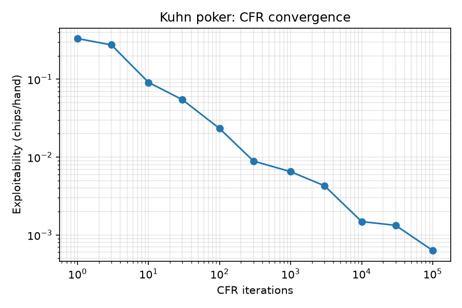

# Kuhn Poker CFR

A Python implementation of **counterfactual regret minimization (CFR)** that learns an equilibrium strategy for Kuhn poker through self-play, plus exact evaluation: expected value, best-response exploitability, and head-to-head results against baseline opponents.

## What it shows

- Vanilla CFR over all 6 deals converges to a Nash equilibrium of Kuhn poker.
- The learned strategy lands inside the known one-parameter equilibrium family (alpha in [0, 1/3]); this run found alpha ≈ 0.22.
- Player 1's game value converges to the analytic **-1/18 ≈ -0.0556** chips/hand.
- **Exploitability** is computed exactly (enumerating all 64 pure best responses per seat) and shrinks steadily as iterations grow.



## Results

Produced by `scripts/run_experiments.py` (full numbers in `results/results.json`):

| Metric | Value |
|---|---|
| Iterations | 100,000 |
| Training runtime | ~7.5 s (Python, single core) |
| Final exploitability | 0.000633 chips/hand |
| Game value (P1) | -0.05555 (exact: -0.05556) |

| Opponent | Avg chips/hand (exact, both seats) | Win rate (100,000 sampled hands) |
|---|---|---|
| always-call | +0.1852 | 49.9% |
| always-bet | +0.1118 | 40.7% |
| random | +0.1481 | 48.2% |
| heuristic (value-bet K, call Q/K, never bluff) | +0.0000 | 50.1% |

Win rate counts hands where the bot nets chips; it can be below 50% while still winning chips, because the bot folds weak hands cheaply and wins bigger pots against bettors. The heuristic opponent breaks even against the learned strategy (exactly 0 to four decimals).

Runtime and sampled win rates vary slightly by machine and seed (seed 0 is used).

## Run it

```bash
python3 -m venv .venv && source .venv/bin/activate
pip install -e ".[dev]"

pytest --cov=kuhn                          # 34 tests
PYTHONPATH=. python scripts/run_experiments.py   # regenerates results/
```

## Layout

```
kuhn/game.py        rules, infosets, payoffs
kuhn/cfr.py         vanilla CFR trainer (regret matching, average strategy)
kuhn/evaluate.py    expected value, exact best response, exploitability, head-to-head
kuhn/baselines.py   always-call, always-bet, random, heuristic
tests/              pytest suite (100% line coverage)
scripts/            experiment runner that writes results/
```

## Tests

Cover payoffs and terminal states, strategy probabilities summing to 1, the learned strategy matching the equilibrium family, game value ≈ -1/18, exploitability decreasing with iterations, and baseline evaluation.

## Possible extensions

Leduc hold'em, Monte Carlo CFR (external / outcome sampling), a CLI to play against the bot.
